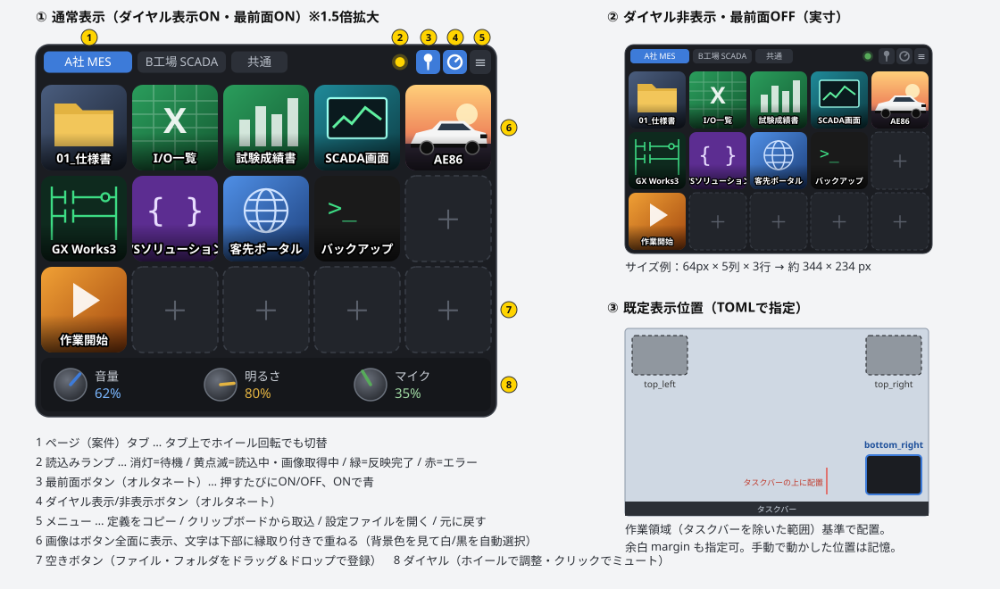
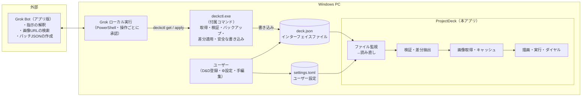
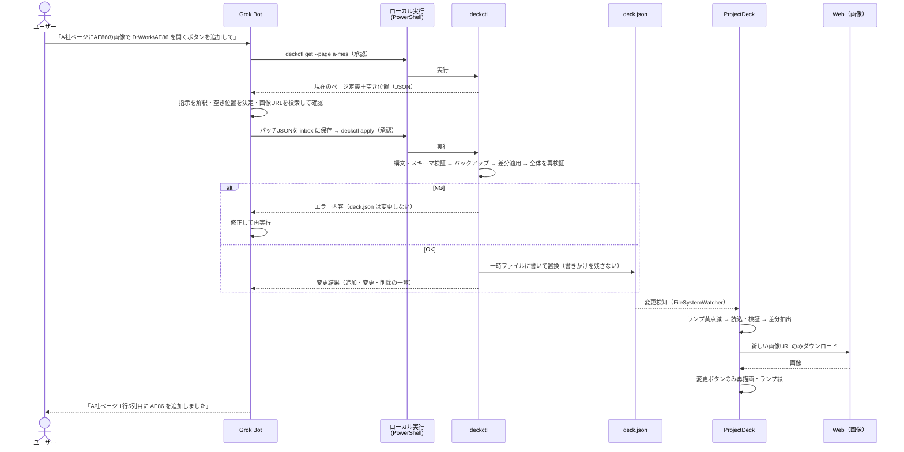

# ProjectDeck 仕様書（ドラフト v0.9）

> Stream Deck風 PCランチャー ／ 外部AI（Grok Bot）からはインターフェイスファイル経由で割付変更

| 項目 | 内容 |
|---|---|
| 文書種別 | 機能仕様書（構想〜基本設計レベル） |
| 版数 | v0.9 |
| 作成日 | 2026-11-07（最終更新 2026-11-08） |
| 対象OS | Windows 10 / 11（64bit）専用 |
| 想定利用者 | 本人（社内PC・自分専用ツール） |
| 関連文書 | `Grok用プロンプト.md`（Grok Botへの指示文・確認メッセージ） |

---

## 1. 目的・背景

- 複数案件を並行して進めているため、案件ごとのフォルダ・Excel・ツールへのショートカットがデスクトップにあふれて煩わしい。
- **案件（ページ）単位で切り替えられる、画像付きボタンのコンパクトなランチャー**を作り、ワンクリックでフォルダ・ファイル・アプリを開けるようにする。
- ボタンの登録は手作業ではなく、**Grok Botに日本語で指示 → Grokがインターフェイスファイル（JSON）を書き換え → ランチャーが変更を検知して即時反映**、という流れで行う。
- ボタン画像もGrokにネットから探させ、ランチャー側で取得して割り付ける（例：「AE86の画像で」）。
- 下部のダイヤルをマウスホイールと連動させ、音量・明るさなどを調整する（表示/非表示切替可）。

---

## 2. 主な変更点（v0.1 → v0.9）

| No  | 変更内容                                                                                                        |
| --- | ----------------------------------------------------------------------------------------------------------- |
| 1   | 全体をコンパクト化。ボタンを64px（可変）に縮小し、**画像はボタン全面**、文字は画像の上に縁取り付きで重ねる（Stream Deck風）                                     |
| 2   | **最前面ボタン（オルタネート）** を追加                                                                                      |
| 3   | Grok連携（Bridge Agent・API呼び出し）を廃止。**本アプリはインターフェイスファイル（JSON）を監視して読み直すだけ**の構成に変更                                |
| 4   | Grok連携表示を廃止し、**読込みランプ**を追加                                                                                  |
| 5   | **ダイヤル表示/非表示ボタン**を追加                                                                                        |
| 6   | Grok用のJSONとは別に、**ユーザー設定ファイル（TOML）** を追加（行数・列数・表示位置など）                                                       |
| 7   | 既定の表示位置を「左上／右上／右下（タスクバーの上）」からTOMLで指定                                                                        |
| 8   | 開発言語を見直し、速度重視で **C# + .NET + WinForms（自前描画）** を推奨                                                           |
| 9   | Grok Bot用プロンプト（スキル化用）と、Grok Botへの確認メッセージを別紙で用意                                                              |
| 10  | 外部モニタの明るさ調整（DDC/CI）、外部機器連携は対象外に                                                                             |
| 11  | **（v0.3）PC起動時の自動実行**をTOMLに追加                                                                                |
| 12  | **（v0.3）設定ボタン（⚙）と設定ダイアログ**を追加。TOMLの項目を画面からも変更可能に                                                            |
| 13  | **（v0.4）Grokの受け渡しをルートA（ローカル実行）に確定**。Grokは変更部分（パッチ）を作り、付属コマンド **deckctl** で deck.json を書き換える。ルートB（コピー＆取込）は予備 |
| 14 | **（v0.5）ルートB（定義コピー／クリップボード取込）と、本体の「元に戻す」を削除**（過剰機能と判断）。ホットキーは表示/非表示の1つだけに。履歴と `deckctl undo` は残す |
| 15 | **（v0.5）フェーズ1の実装で決めた細部を反映**（state.json、PROJECTDECK_HOME、ページ削除の扱い、元に戻すの動き 等） |
| 16 | **（v0.6）フェーズ2（画像URLの取得・加工・キャッシュ）を実装**。7.1 に取得・チェック・失敗時の扱いの詳細を追記。`check-image` は幅・高さと短辺64pxのチェックを追加 |
| 17 | **（v0.7）ツールバーを大きく**（26px → 32px）。タブを高さ22px・文字12pxに、右の部品を22px角に。隠れたタブを示す ‹ › を追加 |
| 18 | **（v0.8）フェーズ3（ダイヤル）を実装**。8章に見た目・操作・各機能の実現方法・表示更新・検証を追記 |
| 19 | **（v0.9）MCP サーバー対応を検討し、保留**。Grok Bot は PC 内の MCP に接続できないため。13章（将来の検討事項）と Q-8 に記録 |

---

## 3. 全体イメージ

### 3.1 画面イメージ



SVGを表示できない環境向けの簡易版：

```
┌──────────────────────────────────────┐
│[A社 MES][B工場 SCADA][共通]  ● 📌 ◎ ⚙ ≡│ ← ●読込みランプ 📌最前面 ◎ダイヤル表示 ⚙設定 ≡メニュー
│┌────┐┌────┐┌────┐┌────┐┌────┐│
││(画像)││(画像)││(画像)││(画像)││(画像)││   画像はボタン全面
││仕様書 ││I/O一覧││成績書 ││SCADA ││AE86  ││   文字は下部に縁取りで重ねる
│└────┘└────┘└────┘└────┘└────┘│
│┌────┐┌────┐┌────┐┌────┐┌────┐│
││GX W3 ││VS開発 ││ポータル││バックアップ││  ＋  ││
│└────┘└────┘└────┘└────┘└────┘│
│┌────┐┌────┐┌────┐┌────┐┌────┐│
││作業開始││  ＋  ││  ＋  ││  ＋  ││  ＋  ││
│└────┘└────┘└────┘└────┘└────┘│
│ (◎)音量62%   (◎)明るさ80%   (◎)マイク35% │ ← ダイヤル（非表示にできる）
└──────────────────────────────────────┘
```

### 3.2 システム構成図

本アプリは**ファイルを監視して読み直すだけ**。誰が書き換えたか（Grok／自分／他ツール）は問わない。
Grokは「ローカル実行」でPC上のPowerShellを操作し、付属コマンド `deckctl` 経由で deck.json を書き換える。



### 3.3 処理シーケンス（v0.5）



- Grokは deck.json を**丸ごと書き直さない**。変更部分だけのパッチを作り、適用は deckctl が行う（Grok自身も「チャットでの全体再出力では無変更部分の完全保持を保証できない」と回答しているため）。
- ローカル実行の各操作にはユーザーの承認が必要。PCがオンラインであることが前提。
- ルートB（チャット経由のコピー＆取込）は v0.5 で廃止。Grok との受け渡しはファイル（inbox のパッチ → deckctl）だけで行う。ローカル実行が使えないときは、Grok がチャットに出したパッチをユーザーが inbox に保存し、`deckctl apply` を実行すれば同じことができる。

---

## 4. 機能一覧

| No | 機能 | 概要 | フェーズ |
|---|---|---|---|
| F-01 | ボタングリッド表示 | 画像全面＋文字重ねのボタンを格子状に表示（行列数はTOML） | 1 |
| F-02 | ページ（案件）切替 | タブで切替。タブ上のホイール回転でも切替 | 1 |
| F-03 | アクション実行 | フォルダ／ファイル／アプリ／URL／複数動作／ページ移動 | 1 |
| F-04 | インターフェイスファイル監視 | deck.json の変更を検知して読み直し・即時反映 | 1 |
| F-05 | ユーザー設定（TOML） | 行列数・ボタンサイズ・表示位置・ホットキー等。変更も即時反映 | 1 |
| F-06 | 検証・履歴 | 不正な定義は反映しない。変更前の状態を履歴に保存（戻すのは `deckctl undo`） | 1 |
| F-07 | 読込みランプ | 待機／読込中／完了／エラーを色で表示 | 1 |
| F-08 | 最前面ボタン | オルタネート（押すたびON/OFF） | 1 |
| F-09 | 常駐・ホットキー | タスクトレイ常駐、ホットキー（Windows 全体で有効）で表示/非表示 | 1 |
| F-10 | 手動登録 | ファイル・フォルダを空きボタンへD&Dで登録（deck.jsonに書き込み） | 1 |
| F-12 | 画像取得・キャッシュ | JSON内の画像URLを取得し、加工してキャッシュ | 2 |
| F-13 | 画像フォールバック | 取得失敗時は関連付けアイコン or 文字アイコン | 2 |
| F-14 | ダイヤル | ホイールで音量・マイク・明るさ。表示/非表示切替 | 3 |
| F-15 | 設定ダイアログ | ⚙ボタンから settings.toml の内容を画面で変更 | 1 |
| F-16 | PC起動時の自動実行 | TOML／設定ダイアログでON/OFF | 1 |
| F-17 | deckctl（付属コマンド） | Grokのローカル実行から deck.json を安全に取得・更新するコンソールコマンド | 1 |

---

## 5. 画面仕様

### 5.1 ウィンドウ構成

| 部位 | 内容 |
|---|---|
| ツールバー（高さ約32px） | 左：ページタブ（高さ22px・文字12px）／右：読込みランプ・最前面ボタン・ダイヤル表示ボタン・設定ボタン・メニュー（各22px角）。タブが入りきらないときは選択中のタブが見える位置から並べ、隠れたタブがある側に ‹ › を表示（タブの上でホイールを回すと切替） |
| ボタングリッド | 行数×列数はTOMLで指定。ボタンサイズ既定64px、間隔4px |
| ダイヤル部（高さ約40px） | 最大4個。非表示時はウィンドウの高さごと縮む |
| 枠 | タイトルバーなし（枠なしウィンドウ）。ツールバーの空き部分をドラッグして移動 |

サイズ：64px × 5列 × 3行 → 約 **344 × 240px**（ダイヤル表示時 約 344 × 284px）。v0.7 でタブを読みやすくするためツールバーを 26px → 32px に広げた（画面イメージ（モック）は v0.4 時点の 26px のまま）。表示倍率（125%・150% など）に合わせて全体を拡大する。

### 5.2 ボタン

| 項目 | 仕様 |
|---|---|
| 画像 | **ボタン全面に表示**（縦横比を保って全面を埋め、はみ出しは切り取り＝cover）。角丸 |
| 文字 | ボタン下部に重ねて表示。下部に薄い黒グラデーションを敷き、文字には縁取りを付けて、どんな画像でも読めるようにする |
| 文字色 | 既定 `auto`：画像下部の明るさを判定して白文字（黒縁）／黒文字（白縁）を自動選択。ボタン単位で色指定も可 |
| 文字数 | 1行。はみ出す場合は自動で文字を縮小（下限7pt）→それでも入らなければ末尾「…」 |
| 画像なし | ①対象ファイルの関連付けアイコン（Excel等）を中央に大きく表示 → ②ラベル頭文字＋自動配色の文字アイコン |
| 状態 | 対象パスが存在しない（NAS未接続など）場合は暗く表示＋⚠マーク |
| 操作 | 左クリック：実行／右クリック：メニュー（場所を開く・パスをコピー・削除）／ホバー：パスをツールチップ表示 |
| 押下表示 | 押した瞬間に少し縮む（Stream Deck風のフィードバック） |

### 5.3 ツールバーのボタン

| 部品 | 動作 |
|---|---|
| 読込みランプ | 下表参照。赤のときクリックでエラー内容（ファイル名・行番号・理由）を表示 |
| 最前面ボタン（📌） | **オルタネート**。押すたびに最前面ON/OFF。ONで青表示。状態は次回起動時も保持 |
| ダイヤル表示ボタン（◎） | **オルタネート**。ダイヤル部の表示/非表示。状態は次回起動時も保持 |
| 設定ボタン（⚙） | 設定ダイアログを開く（5.5参照） |
| メニュー（≡） | deck.jsonを開く／settings.tomlを開く／データフォルダを開く／既定位置に戻す／終了（ツールバー以外の余白の右クリックでも開く） |

#### 読込みランプの状態

| 色 | 意味 |
|---|---|
| 消灯（灰） | 待機中 |
| 黄・点滅 | 変更検知〜読込中、画像ダウンロード中 |
| 緑（3秒後に消灯） | 反映完了 |
| 橙 | 一部警告あり（画像取得失敗→代替アイコン使用、グリッド外のボタンあり 等）。反映はされている |
| 赤（点灯継続） | エラー。反映していない（直前の状態のまま） |

### 5.4 表示位置

- TOMLの `position` で既定位置を指定：`top_left` ／ `top_right` ／ `bottom_right`
- **作業領域（タスクバーを除いた範囲）基準**で配置するため、`bottom_right` はタスクバーのすぐ上になる。
- `margin`（画面端からの余白）、`monitor`（primary／番号）を指定可能。
- ドラッグで動かした場合はその位置を記憶。メニューから「既定位置に戻す」。

### 5.5 設定ダイアログ

⚙ボタンで開く。settings.toml の全項目を画面から変更できる。**TOMLを直接編集しても、ダイアログで変更しても結果は同じ**（どちらも settings.toml に保存され、即時反映）。

```
┌─ ProjectDeck 設定 ──────────────────────────┐
│ [レイアウト][ウィンドウ][起動][文字][ダイヤル][ホットキー][詳細] │
│ ─────────────────────────────────── │
│  縦の数     [ 3 ▲▼]      横の数   [ 5 ▲▼]              │
│  ボタンサイズ [ 64 ▲▼] px  間隔     [ 4 ▲▼] px            │
│  角丸       [ 8 ▲▼] px                                    │
│                                                          │
│  ┌ プレビュー ───────┐                                   │
│  │ ▢▢▢▢▢          │  ← 値を変えるとその場で表示が変わる   │
│  │ ▢▢▢▢▢          │                                   │
│  │ ▢▢▢▢▢          │                                   │
│  └─────────────┘                                   │
│                                                          │
│ [settings.tomlを開く]        [既定値に戻す] [キャンセル] [OK] │
└──────────────────────────────────┘
```

| タブ | 主な項目 |
|---|---|
| レイアウト | 縦の数、横の数、ボタンサイズ、間隔、角丸 |
| ウィンドウ | 表示位置（左上／右上／右下）、モニタ、余白、最前面、不透明度、実行後に隠す |
| 起動 | **PC起動時に自動実行**、起動時に表示する／トレイに隠して起動、起動遅延（秒） |
| 文字 | フォント、サイズ、文字色（自動／白／黒／指定色） |
| ダイヤル | 表示/非表示、ダイヤルごとの機能・刻み幅 |
| ホットキー | 表示/非表示（キーを押して登録、Backspace で解除） |
| 詳細 | deck.json の場所、読込待ち時間、履歴世代数、画像のタイムアウト・最大サイズ・プロキシ |

| 項目 | 仕様 |
|---|---|
| 反映 | 値を変えるとプレビューに即反映。OKで保存・本体に反映、キャンセルで元に戻す |
| 入力チェック | 範囲外の値（縦の数0など）は入力欄を赤くし、OKを押せないようにする |
| TOMLのコメント保持 | ダイアログで保存しても、settings.toml に手で書いたコメントや並び順は消さない（値の部分だけ書き換える） |
| 同時編集 | ダイアログを開いている間に settings.toml が外部で変更された場合は「ファイルが変更されました。読み直しますか？」と確認 |

### 5.6 PC起動時の自動実行

| 項目 | 仕様 |
|---|---|
| 設定 | settings.toml の `[startup] auto_start = true`、または設定ダイアログの「起動」タブ |
| 方式 | ログオンしたユーザーのスタートアップ（レジストリ `HKCU\Software\Microsoft\Windows\CurrentVersion\Run`）に登録／解除。管理者権限は不要 |
| 反映 | auto_start を切り替えた時点で、アプリがレジストリの登録・解除を行う |
| 起動遅延 | `delay_sec` 秒待ってから起動処理（ログオン直後の負荷を避ける。既定 0） |
| 起動時の表示 | `show_on_start = false` ならトレイに隠して起動（ホットキーで表示） |
| exeの場所が変わった場合 | 起動時に登録内容と自分のexeの場所を比べ、違えば登録を更新（C:\Tools への更新配布に対応） |
| 二重起動 | 2つ目を起動した場合は、既に起動しているランチャーを表示して終了 |
| 登録しない場合 | 開発中のビルド（`bin\` フォルダの exe）と、動作確認用フォルダ（`PROJECTDECK_HOME`）で動かしているときは、レジストリに触れない |

---

## 6. ファイル仕様

| ファイル | 形式 | 書く人 | 内容 |
|---|---|---|---|
| `settings.toml` | TOML | ユーザー | 見た目・動作の設定（行列数、サイズ、位置、ホットキー等） |
| `deck.json` | JSON | **Grok**（deckctl 経由）／ アプリ（D&D登録・削除時）／ ユーザー | ページとボタンの割付（インターフェイスファイル） |
| `history\` | JSON | アプリ・deckctl | deck.json の変更前の状態（既定30世代） |
| `inbox\` | JSON | Grok | パッチの置き場所。適用後は `inbox\done\` へ移動 |
| `state.json` | JSON | アプリ | ドラッグで動かした位置・最後に開いていたページ（設定ではないので settings.toml と分ける） |
| `cache\images\` | PNG | アプリ | 取得した画像のキャッシュ（URLのハッシュ名で保存） |
| `logs\` | テキスト | アプリ | 動作ログ（日別） |

配置場所（既定）：`%USERPROFILE%\ProjectDeck\`。環境変数 `PROJECTDECK_HOME` を設定するとそのフォルダを使う（本体・deckctl とも。普段のデータに触れずに動作確認するため）

### 6.1 settings.toml（ユーザー設定）

```toml
# ProjectDeck ユーザー設定

[layout]
rows = 3               # 縦の数
cols = 5               # 横の数
button_size = 64       # ボタン1個の大きさ(px)
gap = 4                # ボタンの間隔(px)
corner_radius = 8      # 角丸(px)

[window]
position = "bottom_right"   # top_left / top_right / bottom_right
monitor = "primary"         # primary または 1,2,...
margin = 8                  # 画面端(タスクバー)からの余白(px)
topmost = true              # 起動時の最前面（📌ボタンで切替、切替結果はここに保存）
opacity = 1.0               # 不透明度 0.3〜1.0
hide_after_launch = false   # ボタン実行後にランチャーを隠すか

[startup]
auto_start = true      # PC起動（ログオン）時に自動実行
show_on_start = true   # false ならトレイに隠して起動
delay_sec = 0          # 起動を遅らせる秒数

[dial]
visible = true         # 起動時のダイヤル表示（◎ボタンで切替、切替結果はここに保存）

[label]
font = "Meiryo UI"
size = 9               # pt
color = "auto"         # auto / white / black / "#RRGGBB"

[hotkey]
toggle = "Ctrl+Alt+Space"       # 表示/非表示（Windows 全体で有効。空欄なら使わない）

[interface]
path = "%USERPROFILE%\\ProjectDeck\\deck.json"
debounce_ms = 300      # 変更検知後、読み込むまでの待ち時間
history = 30           # 履歴の保存世代数

[image]
download_timeout_sec = 10
max_size_mb = 5
proxy = "system"       # system / none / "http://proxy:8080"
```

- `rows` `cols` を変えるとその場でグリッドが組み直される。
- deck.json 側にグリッド外（例：4行目）のボタンがある場合は表示せず、ランプを橙にして通知（データは消さない）。
- 📌・◎ボタンで切り替えた状態は、アプリが `topmost` `visible` の値だけを書き戻す（コメントや他の行は保持）。
- すべての項目は⚙設定ダイアログからも変更できる（5.5）。

### 6.2 deck.json（インターフェイスファイル）

#### サンプル

```json
{
  "schema": "projectdeck/1",
  "revision": 43,
  "updated_by": "grok",
  "pages": [
    {
      "id": "a-mes",
      "name": "A社 MES",
      "color": "#3d7bd9",
      "vars": { "root": "D:/Work/A社_MES改造" },
      "buttons": [
        {
          "id": "a-mes-001",
          "row": 1, "col": 1,
          "label": "01_仕様書",
          "action": { "type": "open_folder", "path": "${root}/01_仕様書" }
        },
        {
          "id": "a-mes-002",
          "row": 1, "col": 2,
          "label": "I/O一覧",
          "action": { "type": "open_file", "path": "${root}/02_設計/IO一覧.xlsx" }
        },
        {
          "id": "a-mes-005",
          "row": 1, "col": 5,
          "label": "AE86",
          "image": { "url": "https://upload.wikimedia.org/.../AE86.jpg", "query": "Toyota AE86" },
          "action": { "type": "open_folder", "path": "D:/Work/AE86" }
        },
        {
          "id": "a-mes-011",
          "row": 3, "col": 1,
          "label": "作業開始",
          "image": { "color": "#f0a035" },
          "action": {
            "type": "multi",
            "delay_ms": 500,
            "steps": [
              { "type": "open_folder", "path": "${root}" },
              { "type": "open_file", "path": "${root}/作業日報.xlsx" },
              { "type": "run", "path": "C:/Program Files (x86)/MELSOFT/Navigator/GXW3.exe" }
            ]
          }
        }
      ]
    }
  ],
  "dials": [
    { "index": 1, "label": "音量",   "function": "master_volume", "step": 2 },
    { "index": 2, "label": "明るさ", "function": "brightness",    "step": 5 },
    { "index": 3, "label": "マイク", "function": "mic_volume",    "step": 2 }
  ]
}
```

#### 項目定義

| キー | 必須 | 型 | 説明 |
|---|---|---|---|
| `schema` | ○ | 文字列 | 固定 `projectdeck/1` |
| `revision` | ○ | 整数 | 書き換えるたびに+1 |
| `updated_by` | − | 文字列 | `grok` / `user` / `app` 等（ログ用） |
| `pages[].id` | ○ | 文字列 | ページID（英小文字・数字・ハイフン） |
| `pages[].name` | ○ | 文字列 | タブ表示名（短く） |
| `pages[].color` | − | 文字列 | タブの色 |
| `pages[].vars` | − | 辞書 | `${名前}` で使える変数（案件の基準フォルダ等） |
| `pages[].archived` | − | 真偽 | `true` でタブを非表示（終了案件） |
| `buttons[].id` | ○ | 文字列 | ボタンID（`<ページID>-<3桁連番>`） |
| `buttons[].row` / `col` | ○ | 整数 | 位置（1始まり）。ページ内で重複不可 |
| `buttons[].label` | ○ | 文字列 | 表示文字（全角6文字程度まで推奨） |
| `buttons[].image` | − | オブジェクト | 下表 |
| `buttons[].label_color` | − | 文字列 | `auto` / `white` / `black` / `#RRGGBB` |
| `buttons[].action` | ○ | オブジェクト | 6.3 参照 |
| `dials[]` | − | 配列 | ダイヤル割付（`function`：`master_volume` / `mic_volume` / `brightness` / `app_volume`(+`process`) / `none`） |

`image` の指定方法（どれか1つ）：

| キー | 内容 |
|---|---|
| `url` | 画像の直接URL（アプリがダウンロード）。`query` に検索語、`license` にライセンスを残しておく |
| `file` | ローカル画像のパス |
| `data` | Base64画像（小さいアイコン向け。通常はurlを推奨） |
| `color` | 単色背景＋文字アイコン |
| （省略） | 関連付けアイコン → 文字アイコンの順で自動 |

#### パス表記のルール

- JSONでは `\` を `\\` と書く必要があり、AIが間違えやすいので **`/` 区切りでも可**とする（アプリ側で `\` に変換）。
- `%USERPROFILE%` などの環境変数、`${変数}` を展開する。
- UNCパス（`//nas01/share/...` または `\\\\nas01\\share\\...`）可。

### 6.3 deckctl（付属コマンド）

Grokのローカル実行（PowerShell）から呼ぶためのコンソールコマンド。本体と同じフォルダに置く（例：`C:\Tools\ProjectDeck\deckctl.exe`）。
検証処理は本体と同じものを使うため、**deckctlでOKなら本体でも必ず反映できる**。

| コマンド | 内容 |
|---|---|
| `deckctl get` | 全ページの一覧（ID・名前・ボタン数・空き数）を出力 |
| `deckctl get --page <ID>` | 指定ページの定義と `_info`（行列数・空き位置・次のボタンID）を出力 |
| `deckctl apply <パッチファイル>` | パッチ（mergeモードJSON）を検証 → バックアップ → 適用 → 全体を再検証 → 書き込み |
| `deckctl apply <パッチ> --dry-run` | 書き込まずに、適用したらどう変わるかだけ出力 |
| `deckctl validate` | 現在の deck.json を検証 |
| `deckctl undo` | 1つ前の履歴に戻す（使った履歴は消すので、繰り返すとさらに前に戻る。revision は+1、updated_by は `undo`） |
| `deckctl check-image <URL>` | URLが画像として使えるか確認（7.1 と同じチェック）。出力に HTTP状態・形式・バイト数・幅・高さ・エラー理由。使えなければ終了コード1 |

| 項目 | 仕様 |
|---|---|
| 出力 | すべてJSONで標準出力（AIが読み取りやすいように）。例：`{"ok":true,"added":["a-mes-005"],"changed":[],"deleted":[],"warnings":[]}` |
| 終了コード | 0：成功／1：検証エラー（deck.json 変更なし）／2：ファイル競合・読み書き失敗 |
| 文字コード | 入力はUTF-8（BOMあり・なし両対応。PowerShell 5.1 の `Set-Content -Encoding UTF8` はBOM付きになるため） |
| パッチの置き場所 | `%USERPROFILE%\ProjectDeck\inbox\`。適用後は `inbox\done\` へ移動（記録として残す） |
| 競合対策 | 書き込み時にロックファイルを使い、本体のD&D登録などと同時に書かない。取れなければ最大3秒待って終了コード2 |
| 大量削除の保護 | 1回でボタンが5個以上減るパッチは `--force` が無いと拒否 |
| ページの削除 | パッチではページを削除できない（`"delete": true` はエラー）。終了した案件は `"archived": true` |
| 別ページへの移動 | 他のページにある同じIDのボタンをパッチに書くと「移動」として扱う（元のページから消える） |
| 対象の指定 | `--deck <パス>` で deck.json を指定できる（既定は settings.toml の `[interface] path`） |
| 画像URLの事前確認 | apply時に新しい `image.url` を簡易チェックし、取得できなければ warnings に出す（適用はする） |

### 6.4 アクション種別

| type | 動作 | パラメータ |
|---|---|---|
| `open_folder` | エクスプローラーでフォルダを開く | `path` |
| `open_file` | 関連付けアプリでファイルを開く（Excel等） | `path` |
| `run` | exe / bat を起動 | `path`, `args`, `workdir` |
| `open_url` | 既定ブラウザでURLを開く | `url` |
| `multi` | 複数のアクションを順に実行 | `steps[]`, `delay_ms` |
| `page` | 別のページへ切替 | `target` |

---

## 7. 読込み・反映処理の詳細

| 項目 | 仕様 |
|---|---|
| 監視対象 | `deck.json` と `settings.toml`（どちらも即時反映） |
| 書きかけ対策 | 変更検知後 `debounce_ms`（300ms）待ってから読込。読込失敗（ロック中・JSON途中）は100ms間隔で最大5回リトライ |
| 自己書き込みの無視 | アプリ自身が書いた内容はハッシュで判定し、二重に読み直さない |
| 検証 | ①JSON構文 ②スキーマ（必須項目・型） ③位置重複 ④IDの重複 ⑤アクション種別 |
| 検証NG | **反映しない**。直前の状態で表示を継続し、ランプ赤。エラー内容をログとランプクリックで表示 |
| 差分反映 | 前回とボタン単位で比較し、**変わったボタンだけ**画像取得・再描画（全体を作り直さない） |
| 大量削除の保護 | 1回の変更でボタンが5個以上減った場合は確認ダイアログ（Grokが既存ボタンを書き漏らした時の保険）。「いいえ」なら deck.json を直前の状態に書き戻し、今回の内容は履歴に残す |
| 履歴 | 書き換える前の状態を `history\deck_yyyyMMdd_HHmmss_fff.json` に保存（直近と同じ内容なら保存しない）。戻すのは `deckctl undo` のみ（本体に「元に戻す」は無い） |

### 7.1 画像の取得

| 項目 | 仕様 |
|---|---|
| 取得タイミング | deck.json を反映したときに、まだキャッシュに無い `image.url` を取りにいく（表示していないページの分も先に取得）。キャッシュにあれば再取得しない |
| 同時に取得する数 | 2件まで。取得は別スレッドで行い、画面は止めない。取得中はランプ黄点滅、その間のボタンは代替アイコン |
| チェック | ①HTTP 200 ②画像形式か（先頭バイトで判定：PNG/JPG/GIF/WebP/BMP/ICO） ③最大サイズ以下（既定 5MB） ④短辺 64px 以上（ファイルの先頭部分から縦横を読む） |
| 読込 | まず Windows 標準の GDI+、読めない形式（WebP）は Windows の画像コーデック（WIC）で読む。アニメーション GIF は最初のコマ |
| 加工 | 中央基準で正方形に切り取り → 256×256 PNG でキャッシュ（描画時はボタンサイズの画像を事前生成して保持） |
| ファイル名 | `cache\images\<URL の SHA-256 の先頭32桁>.png` |
| 通信の一時的な失敗 | 接続エラー・タイムアウトは1秒おいて1回だけ取り直す |
| 失敗時 | 関連付けアイコン or 文字アイコンで表示し、ランプ橙（クリックで理由と URL を表示）。起動中は同じ URL を再挑戦しない。取り直すのは、右クリック「画像を再取得」、再起動、`[image]` の設定変更のとき |
| 出典 | キャッシュ一覧（`cache\images\index.json`）に、URL ごとに file・query（検索語）・license・fetched（取得日時）・format・width・height・bytes を記録 |
| 利用範囲 | 社内PCでの自分用アイコンに限る（配布・資料への転用はしない）。Wikimedia Commons の画像はCC BY-SA等のライセンス付きなので、出典を記録しておく |

---|---|
| 取得タイミング | 新しい `image.url` が現れたときのみ（キャッシュにあれば再取得しない） |
| チェック | 画像形式か（PNG/JPG/GIF/WebP/BMP/ICO）、5MB以下、短辺64px以上 |
| 加工 | 中央基準で正方形に切り取り → 256×256 PNG でキャッシュ（描画時はボタンサイズの画像を事前生成して保持） |
| 失敗時 | 関連付けアイコン or 文字アイコンで表示し、ランプ橙。右クリック「画像を再取得」 |
| 出典 | キャッシュ一覧（`cache\images\index.json`）に URL・検索語・取得日時・ライセンスを記録。deck.json の `image.license` に「CC BY-SA 4.0」等を書けるようにする |
| 利用範囲 | 社内PCでの自分用アイコンに限る（配布・資料への転用はしない）。Wikimedia Commons の画像はCC BY-SA等のライセンス付きなので、出典を記録しておく |

---

## 8. ダイヤル仕様（フェーズ3）

| 項目 | 仕様 |
|---|---|
| 表示 | ◎ボタンで表示/非表示。非表示時はウィンドウが縮む。最大4個を横に並べる |
| 見た目 | つまみ・外周の目盛り（左下 -135° ～ 右下 +135°）と今の値までの弧・名前・値（%）。ミュート中は「ミュート」（赤）、使えないときは「--」（灰）。色は 音量=青／明るさ=黄／マイク=緑／アプリ音量=紫 |
| 操作 | ダイヤル上でホイール：増減（1ノッチ＝`step`%）／Shift+ホイール：1%刻み／クリック：ミュート切替（明るさは無効）。細かく回るホイールは1ノッチ分たまってから動かす。ダイヤルの上ではウィンドウのドラッグ移動はしない |
| ツールチップ | 今の値と操作方法。使えないときは理由（例：「入力機器（マイク）がありません」） |
| 音量（master_volume）・マイク（mic_volume） | Windows Core Audio API（NAudio）。既定の出力・入力機器の音量。音量を上げるとミュートは解除（キーボードの音量キーと同じ） |
| アプリ別音量（app_volume） | 音量ミキサーのアプリごとの音量。`process` にプロセス名（例：`spotify`、`.exe` は省略可）。同じプロセスの音声すべてに適用。音を出していないアプリは「--」 |
| 明るさ（brightness） | ノートPC内蔵画面のみ（WMI の WmiMonitorBrightness）。外部モニタは対象外で「--」。一度非対応と分かったら以降は問い合わせない。書き込みは別スレッドで、連続操作は最後の値だけ書く |
| 表示更新 | 音量・マイクは Windows からの通知で、他のアプリ・キーボードで変わっても追従。アプリ別音量・明るさは2秒ごとに読み直す（表示中のみ）。既定の音声機器が変わったら（ヘッドセットを挿したなど）作り直す |
| deck.json の検証 | `index` は 1～4 で重複不可、`step` は 1～100、`app_volume` は `process` が必須 |

---|---|
| 表示 | ◎ボタンで表示/非表示。非表示時はウィンドウが縮む |
| 操作 | ダイヤル上でホイール：増減（1ノッチ＝`step`%）／Shift+ホイール：1%刻み／クリック：ミュート切替（明るさは無効） |
| 音量・マイク | Windows Core Audio API |
| 明るさ | ノートPC内蔵画面のみ（WMI）。外部モニタは対象外 |
| 表示更新 | 他のアプリで音量が変わった場合も追従して表示 |

---

## 9. 開発言語の提案

### 9.1 結論

**C#（.NET 10 LTS）＋ WinForms（ボタン部分は自前描画）＋ ReadyToRun コンパイル** を推奨します。

### 9.2 比較

| 候補 | 起動・動作の速さ | 開発のしやすさ | コメント |
|---|---|---|---|
| **C# + WinForms（自前描画）** | ◎ | ◎ | 軽量で起動が速い。Windows APIを呼びやすい。情報・ライブラリが最も多い。**推奨** |
| VB.net + WinForms | ◎ | ○ | 速さはC#と同じ（同じ.NET）。ただしVBは言語の新機能追加が止まっており、サンプルやライブラリの情報がC#中心 |
| C# + WPF | ○ | ○ | 見た目の自由度は高いが、起動とメモリがWinFormsより重め。ランチャー用途では過剰 |
| C++ / Rust（Win32直接） | ◎◎ | △ | 最速だが、開発・保守の手間が大きい。体感差はほぼ出ない |
| Python | △ | ◎ | 起動が遅く、exe化すると重くなる。常駐ランチャーには不向き |

- VB.netが読めれば、C#は同じ.NETなので書き方の違いだけで、クラス・ライブラリはそのまま共通です。
- 常駐アプリなので、普段の「表示/非表示」は起動ではなくウィンドウの出し入れで済み、体感はほぼ瞬時になります。

### 9.3 速度のための設計方針

| 方針 | 内容 |
|---|---|
| 常駐＋非表示 | 閉じずに隠すだけ。ホットキーでの表示は 50ms 以内を目標 |
| 自前描画 | ボタン1個ずつコントロールを作らず、グリッド全体を1枚のキャンバスに描画（ダブルバッファ） |
| 画像の事前縮小 | 読込時にボタンサイズの画像を作っておき、描画時は貼るだけ |
| 差分更新 | 変わったボタンだけ描き直す |
| 非同期実行 | ファイルを開く処理・画像ダウンロードは別スレッド。UIは止めない |
| JSON高速化 | System.Text.Json（ソース生成）で読み込み |
| ReadyToRun | 事前コンパイルで初回起動を短縮 |

### 9.4 使用ライブラリ（案）

| 用途 | ライブラリ |
|---|---|
| TOML | Tomlyn |
| JSON | System.Text.Json（標準） |
| 音量 | NAudio（Core Audio API） |
| 明るさ | System.Management（WMI） |
| ホットキー・最前面 | Win32 API（RegisterHotKey / SetWindowPos） |
| 関連付けアイコン | Win32 API（SHGetFileInfo / IShellItemImageFactory） |

### 9.5 性能目標

| 項目 | 目標 |
|---|---|
| 起動 | 1秒以内 |
| ホットキーで表示 | 50ms以内 |
| クリック → 開く処理の開始 | 100ms以内 |
| deck.json 変更 → 反映 | 0.5秒以内（画像ダウンロード時間を除く） |
| 待機時 | CPUほぼ0%、メモリ 60MB程度 |

---

## 10. 非機能要件

| 項目 | 要件 |
|---|---|
| 耐障害性 | deck.json が壊れていても起動可能（最後の正常履歴 or 空の状態で起動） |
| オフライン | 画像取得以外はネット接続なしで全機能が動作 |
| 権限 | 通常ユーザー権限で動作 |
| ログ | 実行・反映・エラー・画像取得を日別ログに記録 |
| 配布 | 自作ツールの既存運用（GitHub非公開リポジトリのReleases → C:\Tools）に乗せる |

---

## 11. 開発フェーズ

| フェーズ | 内容 | 完了条件 |
|---|---|---|
| 1 | 画面・ボタン・ページ、TOML、設定ダイアログ、自動実行、deck.json監視・検証・履歴、ランプ、📌、常駐、D&D、**deckctl** | deck.json を書き換えると0.5秒以内にボタンが変わる |
| 2 | 画像URL取得・加工・キャッシュ、フォールバック、Grokスキルの登録・調整 | Grokに「AE86の画像で〜」と頼むだけで（承認操作のみ）画像付きボタンができる |
| 3 | ダイヤル（音量・マイク・明るさ）、◎表示切替 | ホイールで音量・明るさが変わる |

---

## 12. 未決事項

| No | 内容 | 状況 |
|---|---|---|
| Q-1 | Grok Bot（アプリ版）の機能 | **解決**：ローカル実行でPCのファイル操作可（承認制）、画像の直接URL可（3件とも表示確認済）、スキル保存可。ルートA＋deckctl で確定 |
| Q-2 | 社内PCからの外部通信 | 可（解決） |
| Q-3 | 外部AIへの案件情報の送信 | 問題なし（解決） |
| Q-4 | 開発言語 | C# + .NET 10 + WinForms を提案（9章）。ご確認ください |
| Q-5 | ボタン数・位置 | TOMLで定義（解決） |
| Q-6 | 外部モニタの明るさ | 不要（解決） |
| Q-7 | 外部機器連携 | 対象外（解決） |
| Q-8 | MCP サーバー対応（各種AIからの汎用インターフェイス） | **保留**（2026-11-08）。Grok Bot は PC 内の MCP に接続できないため、PC 内で完結させる方針を優先して今は作らない。13章に将来用として記録 |

---

## 13. 将来の検討事項

### 13.1 MCP サーバー対応（保留）

deck.json のやり取り（取得・検証・パッチ適用・元に戻す・画像確認）を MCP（Model Context Protocol）サーバーとして提供し、Grok 以外の AI からも同じ手順でランチャーを操作できるようにする案。2026-11-08 に検討し、**今は作らない**と決めた。

#### 構成案

```
MCP 対応の AI アプリ（この PC 上で動くもの）
        │ MCP（ツール呼び出し）
        ▼
deckctl mcp（deckctl に追加するサブコマンド。Core を共用）
        │ 検証・バックアップ・ロック・安全な書き込み
        ▼
deck.json ──(監視)──▶ ProjectDeck 本体（変更なし）
```

| ツール（案） | 内容 | 対応する deckctl |
|---|---|---|
| `list_pages` | ページ一覧 | `get` |
| `get_page` | ページ定義＋空き位置・次のID | `get --page` |
| `apply_patch` | パッチ適用（`dry_run`・`force` を指定可） | `apply` |
| `check_image` | 画像URLの確認 | `check-image` |
| `undo` | 1つ前に戻す | `undo` |
| `validate` | 検証 | `validate` |

- 接続方式は **stdio（この PC の中だけ）** を前提とする。HTTPS で公開するリモート方式は、社内 PC をインターネットに開けることになるため対象外
- パッチの形式・ルールはツールの説明と入力の型（JSON スキーマ）に持たせ、AI ごとのスキル登録をほぼ不要にする
- MCP 経由で適用したパッチも `inbox\done\` に保存し、deckctl と同じ記録を残す
- 実装は公式の C# 用 MCP SDK（NuGet の `ModelContextProtocol`）で、deckctl に `mcp` サブコマンドを足す形を想定

#### Grok Bot の対応状況（2026-11-08 に Grok へ確認）

| 方式 | 対応 | 補足 |
|---|---|---|
| stdio | ✕（この用途では） | stdio 自体は対応しているが、サーバーを起動するのは Grok 側のコンピュータで、ユーザーの PC ではない |
| ローカル HTTP（`127.0.0.1`） | ✕ | 非対応 |
| インターネット上の HTTPS | ○ | PC を外部から届くようにする必要がある |

- MCP 接続は「ローカル実行」とは別機能で、ローカル実行を有効にしても PC 内の MCP にはつながらない
- 確認に使ったメッセージと回答の要約は `Grok用プロンプト.md` の5章

#### 保留の理由と、再検討するとき

- 「PC の中だけで完結させる」方針を優先する。この条件で Grok Bot が使えるのは、今の「ローカル実行＋deckctl」だけ（2026-11-08 に取得・追加・画像付き・元に戻すを実地で確認済み）
- Grok Bot 以外の AI から操作する具体的な予定がない

次のどれかに当てはまったら再検討する。

- Grok Bot が PC 内の MCP（stdio をユーザーの PC で起動、またはローカル HTTP）に対応した
- Claude Desktop・Claude Code・Cursor など、PC 上で動く AI からもボタンを編集したくなった
- 社内の方針で、PC を外部から届くようにしてよくなった（リモート MCP）

---

## 改版履歴

| 版数 | 日付 | 内容 |
|---|---|---|
| v0.1 | 2026-11-07 | 初版ドラフト作成 |
| v0.2 | 2026-11-07 | コンパクト化・画像全面表示、最前面ボタン、読込みランプ、ダイヤル表示切替、TOML設定追加、インターフェイスファイル方式に変更、開発言語提案、Grok用プロンプト別紙化 |
| v0.3 | 2026-11-07 | PC起動時の自動実行、設定ボタン（⚙）と設定ダイアログを追加。サイズはモックの大きさで確定 |
| v0.4 | 2026-11-07 | Grok確認結果を反映。ルートA（ローカル実行）に確定し、付属コマンド deckctl を追加。画像のライセンス記録を追加 |
| v0.5 | 2026-11-08 | ルートB（定義コピー／クリップボード取込）と本体の「元に戻す」を削除し、ホットキーを表示/非表示のみに。フェーズ1の実装で決めた細部（state.json・inbox・PROJECTDECK_HOME・ページ削除・undo の動き・大量削除時の書き戻し）を反映。以降の仕様書の保守は Claude Code で行う |
| v0.6 | 2026-11-08 | フェーズ2を実装。7.1（画像の取得）に、取得タイミング・同時数・チェック内容・WebP の読込・一時的な失敗の再試行・失敗時の再挑戦条件・キャッシュ一覧の項目を追記。deckctl check-image の出力に幅・高さを追加 |
| v0.7 | 2026-11-08 | ツールバーを 26px → 32px に広げ、タブ（高さ22px・文字12px）と右の部品（22px角）を大きく。ウィンドウの既定サイズを 344 × 240px に。タブが入りきらないときの ‹ › 表示を追加 |
| v0.8 | 2026-11-08 | フェーズ3（ダイヤル：音量・マイク・アプリ別音量・明るさ）を実装。8章を詳細化し、dials の検証（index の重複・step の範囲・app_volume の process 必須）を追記 |
| v0.9 | 2026-11-08 | MCP サーバー対応を検討。Grok Bot は PC 内の MCP に接続できないことを確認し、PC 内で完結させる方針を優先して保留。13章「将来の検討事項」と Q-8 を追加 |
